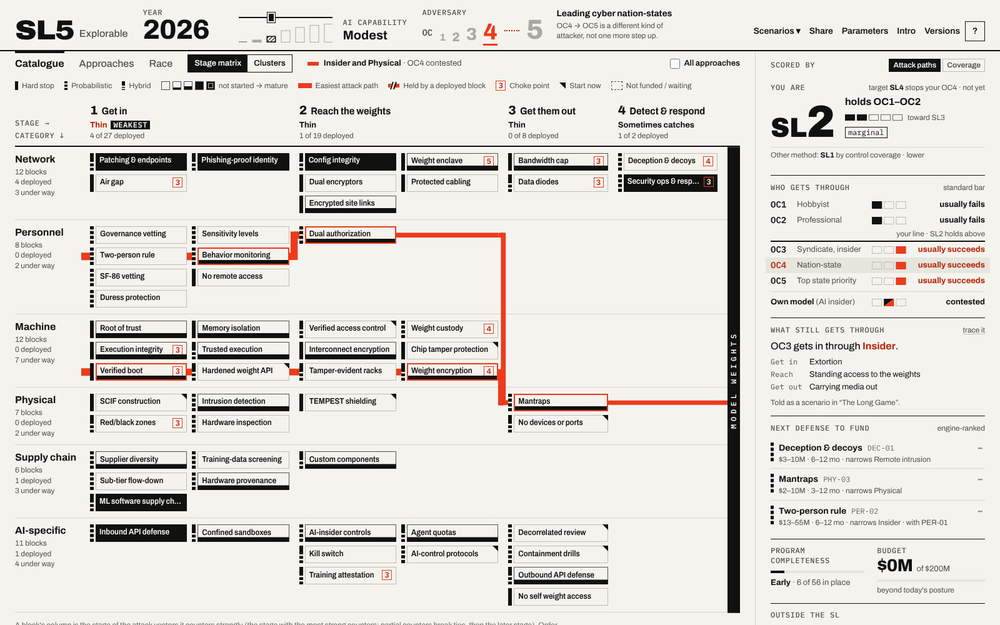

# SL5 Explorable

**An interactive instrument for planning how a frontier AI lab defends its model weights against nation-state attackers.**

**[Live →](https://nitzpo.github.io/sl5/)** (choose a version) · **[v2, current →](https://nitzpo.github.io/sl5/v2/)** · **[v1, original →](https://nitzpo.github.io/sl5/v1/)** · **[Start with the v2 introduction →](https://nitzpo.github.io/sl5/v2/intro/)**



> ⚠️ **Disclaimer.** This is an educational, illustrative model — not authoritative security guidance. The blocks, attack-vector mappings, scenarios, costs, and probabilities are a *modeling interpretation* synthesized from public sources (see [Data & sources](#data--sources)), not official figures. Use it to build intuition, not to make procurement or accreditation decisions.

---

## What is this?

SL5 Explorable is an *explorable explanation* — a manipulable instrument rather than a dashboard or a report. You are planning security for a frontier AI lab: you fund defenses from a catalogue of 56 **building blocks**, set **world assumptions** (AI timeline, budget, government and vendor cooperation, whether the model is served through an API), pick the adversary tier you plan against, and see in real time which attacker tiers your posture usually stops, which **attack path** still gets through, and what to fund next.

"SL5" is the top of a 1–5 **Security Level** scale. Following RAND, SL-n is the level meant to stop an OC-n attacker, and **OC5** is a top-priority state operation willing to spend years and about a billion dollars on the weights. Even **SL4** is out of reach for most labs today.

**Audience:** AI-lab security leaders, policymakers, and the wider AI-security community. The framing is the defender's: the tool is for planning defenses, not attacks.

The tool is built around **two simultaneous races**:

1. **The deployment race** — can defenders stand up enough independent layers *before* the threat arrives? Some blocks (chip-level tamper protection, execution-integrity verification) take four to six years at the slow end, so the decision window is closing now.
2. **The futureproofing race** — which defenses stay effective as AI amplifies attackers? **Hard stops** (air gap, cryptography, memory isolation) erode little; **probabilistic** defenses (monitoring, vetting, review) lose much of their effect against stronger attackers.

### Ideas it tries to make tangible

- **SL5 is extremely hard** — with today's catalogue it is out of reach, as RAND says it currently is.
- **OC4 → OC5 is a qualitative jump**, not just a bigger budget.
- **Strong AI shifts the OC scale** — on code, credential and ML-stack attacks, an attacker with strong AI does what the next tier up does today.
- **Insider threat is a distinct, hard-to-mitigate class** — including the lab's own model acting as an insider.
- **Time pressure is real** — long-lead blocks must be started years ahead.

### What's on screen (v2)

- **The catalogue** is the main screen, in two views. The **stage matrix** lays the blocks out by attack stage (get in, reach the weights, get them out, detect and respond) and category; **clusters** groups them by category around the model weights. The easiest attack path is drawn through both, with break marks where a deployed block holds and badges on choke points. Click a block to advance it (not started → investing → implementing → deployed → mature), right-click to step it back, Shift-click for its detail drawer.
- **The verdict rail** gives the security level as a level plus a progress bar toward the next, flagged *marginal* when it only just holds; a ladder of attacker tiers OC1–OC5 and the lab's own model, each in words (*usually fails*, *contested*, *usually succeeds*); what still gets through; the engine-ranked next defense to fund; programme completeness; the budget; and meters outside the SL. There are no percentages in the UI; the exact estimative word is on hover.
- **Approaches** shows one lane per broad way in (remote intrusion, insider, physical, supply chain, the served model, the lab's own model) along the attacker's easiest path, with your defenses at each stage. **Race** sets long-lead defenses against the moment AI lifts the attacker to the next tier, and plots your SL over the years beside the four scripted stories.
- **Parameters** holds the advanced settings: how strict "stops" is (strict, standard, lenient), the adversary, model serving, AI propensity, the **future capabilities** toggle for five R&D blocks, and the world sliders.
- **Scenarios** plays one-minute stories (Proactive Program, Reactive CISO, Budget-Constrained, Do Nothing, or your own posture run forward in time) with captions in the rail, and saves and reloads postures you name. **Share** copies a link to your posture.

### The introduction

New to the problem? [`/sl5/v2/intro/`](https://nitzpo.github.io/sl5/v2/intro/) is a standalone
14-slide introduction (about six minutes), written for defenders and linked from the app's
`Intro` button and its first-run modal. Act I, *what you're up against*: why the weights are a
target, why AI makes it worse, the OC1–OC5 ladder, what "secure" means here, the lab's own
model as an insider, and the sources. Act II, *how to use the instrument*: the catalogue,
attack vectors and the three stages, approaches and the easiest path, why weak defenses don't
add up, your security level, lead times against the threat front, and a budget game where you
spend $150M on one year of defenses and see which attackers you now stop. Every demo runs on
`scorePosture`, the same pipeline as the app. It's a separate Vite entry point, every slide is
linkable (`/sl5/v2/intro/#the-oc-ladder`), and slugs from v1's introduction still land on the
nearest slide. Unlike the app, it reads fine on a phone.

---

## Versions

Both versions are live on GitHub Pages; [`/sl5/`](https://nitzpo.github.io/sl5/) is a version picker.

| | URL | What it is |
|---|---|---|
| **v2** | [`/sl5/v2/`](https://nitzpo.github.io/sl5/v2/) | The current app, built from this branch's `app/`. |
| **v1** | [`/sl5/v1/`](https://nitzpo.github.io/sl5/v1/) | The original app, frozen at commit `ec5d9bd` (`V1_SHA` in [`.github/workflows/deploy.yml`](.github/workflows/deploy.yml)). |

**v1** (May–August 2026) had 47 blocks on a pan-and-zoom hex map (clusters, grid and rings views),
CISO / Attacker / Policy / Observer panels, and a coverage-based security level (a weighted
mean of how complete each category is). Its threat model was seven narrative attack chains,
each scored as a capability-gated breach probability and shown as a percentage.

**v2** changed the model and the interface:

- **Scoring runs on RAND's attack vectors** (*Securing AI Model Weights*, Tables 5.1 and 5.2)
  instead of the seven chains. The chains survive as illustrative **scenarios**.
- **The security level is threat-relative**: SL-n means OC-n's campaigns usually fail. The
  old coverage score is kept as *programme completeness*.
- **Results are in words**, not percentages, and the level comes with progress toward the next.
- **The catalogue went from 47 to 56 blocks** (fifteen new defenses; overlapping ones merged),
  plus five labelled R&D blocks behind a toggle, and the lab's own model is scored as an insider.
- **A new interface**: the Swiss-style catalogue with its stage matrix and clusters views, the
  verdict rail, Approaches and Race views, the parameters drawer, and a 14-slide intro
  written for defenders.

**Why v1 is kept.** Share links encode a posture in the URL, and a v1 posture read by v2's
model would show different numbers for the same choices. `/sl5/v1/` keeps every link made
before v2 opening the posture it was made with: old `/sl5/#state=…` share links, `?story=…`
links and `/sl5/intro/` deep links redirect there. v1 also stays as a reference for comparing the two
models. Don't move `V1_SHA`; [`site/README.md`](site/README.md) explains the layout and redirects.

---

## How the model works

Everything runs client-side from JSON data — no backend. The model as shipped, with
every formula, constant and the calibration table, is in
[`research/scoring-model.md`](research/scoring-model.md); the engine is
`app/src/engine/` and every number in the UI goes through one function,
`scorePosture` (`posture.ts`).

- **Attack vectors** (`app/public/data/vectors.json`) are the backbone: RAND's 38
  vectors with their Table 5.2 feasibility (1–5) for each attacker tier OC1–OC5
  against a minimally defended lab, read as a probability (1 → 0.02, 2 → 0.3, 3 → 0.5,
  4 → 0.7, 5 → 0.9). Each sits at a **stage**: get in, reach the weights, get them out.
  Two kinds are ours, not RAND's, and labelled as assumptions: 8 vectors for **the
  lab's own model as an insider**, scored per AI-capability band, and 4 **structural
  placeholders** ("nothing stops this stage" at a minimal lab).
- **Approaches** (`approaches.json`) group the vectors into broad ways in — remote,
  insider, physical, supply chain, the served model, and the lab's own model. An
  **attack path** takes one vector per stage, and the engine finds the attacker's
  easiest path in each approach. A **campaign** succeeds if any approach works: every
  attacker tries every approach, most likely first.
- **Building blocks** (`blocks-*.json`, 56 today) each **counter** the vectors they make
  harder, strongly or partially, from a reviewed vector × control map. Counters have
  **diminishing returns**: the best strong counter multiplies a vector by 0.3, further
  counters by 0.8, 0.9 and 0.95, and partials together never beat one strong counter. A
  block's state (not started → mature), the cooperation sliders and its `completed_by`
  companions scale its effect, and counters **erode against stronger attackers**: hard
  stops in a narrow band (0.98 → 0.86 of their effect from OC1 to OC5), probabilistic
  controls in a wide one (0.95 → 0.40), hybrids between.
- **AI lifts the attacker, once.** Each vector carries an authored `ai_shift`: as AI
  capability grows (0 in 2024 → 1 in 2030 on the default curve), an OC-n attacker scores
  like OC-n plus up to one tier on code, credential and ML-stack vectors, and barely
  moves on physical and human ones. Feasibility and counter erosion are both read at
  that tier; defender-side erosion is not applied on top.
- **Detection and a floor.** Security operations and deception give a chance that a
  failed attempt is caught and the campaign stopped (about half when mature, eroded by
  AI). And no campaign reaches zero: a residual floor of 3% of what the same attacker
  gets against an undefended lab applies once per campaign.
- **The security level is threat-relative.** RAND's SL-n is the level meant to stop an
  OC-n actor, so **tier n holds** when fewer than τ of OC-n's campaigns succeed (τ = 0.20
  by default; strict 0.10 and lenient 0.33 in Parameters), and the **SL** is the
  highest n with every tier up to n held. SL5 also requires holding the lab's own model
  as an insider, scored on this year's AI-capability band and multiplied by the chance
  it tries at all (`ai_propensity`). The SL comes with a **progress** bar toward the next
  level (how far that tier has come from certain success to the bar, on a log scale), a
  *marginal* flag, what limits it, and a word per tier — *usually fails*, *contested*,
  *usually succeeds* — rather than a percentage.
- **SL5 is out of reach with today's catalogue**, as RAND says it currently is. A world
  toggle adds five clearly labelled **future capabilities** (verified accelerator
  hardware at scale, a government-cleared workforce with state counter-intelligence, a
  formally verified weight-access stack, a sovereign protected facility, trustworthy AI
  monitors). With all of them and a favourable world, SL5 is reachable for a few years,
  marginally, before AI catches up.
- **Things no lab can do alone** — military takeover, access the organisation itself
  approves — are still scored, flagged, and relieved only by government cooperation.
- **Outside the SL**: API distillation copies capability rather than weights, so it is a
  separate *capability leakage* meter (per campaign, and cumulative since 2026); sabotage
  by the lab's own model is a separate *integrity* meter.
- **Scenarios** (`scenarios.json`) are the former attack chains — *The Quiet Tap*, *The
  Long Game* — retold as specific paths through the vectors. They illustrate; the SL is
  computed over approaches.
- **Programme completeness** is the old coverage score (a weighted mean of block
  effectiveness per category, 0.3·min + 0.7·mean), kept as a secondary readout. It
  measures breadth, not whether any tier holds.
- **Budget** is binding and order-aware: blocks are funded in the order you advanced
  them, a block past the budget line is not built, and controls the lab already runs are
  sunk cost. **Prerequisites** are hard: a block deployed without its `requires` is
  capped at implementing. The **risk-tolerance** slider sets the planning cost basis.
- **Next defense to fund** is not a heuristic: each candidate block (with any missing
  prerequisites) is scored through `scorePosture` and ranked by how much it cuts the
  adversary tier's campaign, plus a quarter of the cut at the tier above, per $M.
- **You don't start from nothing.** The app opens on a researched starting posture from
  each block's `baseline_state` — SL1 in 2026, slipping to SL0 by 2028 if nothing is added,
  as AI lifts attackers past today's controls.

The calibration is honest about what it cannot hold: with the model served, a ~$3B
programme that starts in 2024 reaches SL3 by 2030, only just; the full catalogue never
reaches SL5. The constants that are ours rather than RAND's — the own-model scores, the
structural placeholders, the future blocks, the AI shifts, detection and the floor — are
listed as [authored assumptions](research/scoring-model.md#authored-assumptions). The
reviewed calibration probe is reproduced by the engine as a test fixture, and the places
where the engine departs from it are documented. JSON schemas live in
[`research/schema/`](research/schema/). Most other documents in [`research/`](research/)
record v1-era reasoning ([`research/README.md`](research/README.md) says which); where they
differ, the engine and `scoring-model.md` are authoritative.

### Not modeled (yet)

Ideas the research docs argue for that the simulation does not implement — listed here so the docs don't over-promise:

- **Cross-approach compounds** — an external prompt injection that steers the lab's own
  model, for instance. The campaign is a union over approaches and misses them.
- **Uncertainty bands** on scores (a block's `open_questions` are listed in its detail drawer, not turned into error bars).
- **Split SL** for the same model (weights-at-rest vs served externally) — the serving
  toggle and the capability-leakage meter carry that story instead.

---

## Run locally

```bash
cd app
npm install
npm run dev        # http://localhost:5173/sl5/       — the explorable (v2)
                   # http://localhost:5173/sl5/intro/ — the introduction
```

Locally the app is served at `/sl5/`; the Pages deploy builds the same code with
`--base /sl5/v2/`. Other scripts:

```bash
npm run build      # type-check + production build to app/dist (two pages: / and /intro/)
npm run preview    # serve the production build
npm test           # vitest: engine, store, UI and introduction tests
npm run lint       # eslint
npm run calibrate  # print the calibration tables (research/scoring-model.md, Part 11)
```

Requires Node 20+. The app is desktop-only (it gates screens below 768px); the introduction works on a phone.

To preview the whole Pages site (the picker, v1 and v2 side by side) or refresh the picker's
thumbnails, see [`site/README.md`](site/README.md).

---

## Project structure

```
.
├── app/                      # the React + TypeScript + Vite app (v2)
│   ├── intro/index.html       # second page entry → /sl5/intro/
│   ├── src/
│   │   ├── components/        # catalogue (stage matrix, clusters), rail, approaches, race,
│   │   │                      #   detail and parameters drawers, layout, story playback
│   │   ├── engine/            # vector model, threat-relative SL, budget, AI curve, distillation
│   │   ├── model/             # view models: catalogue and cluster layout, names, words, race
│   │   ├── intro/             # the standalone introduction: slides + its own demos
│   │   ├── store/             # Zustand state (simulation, derived, UI, persistence)
│   │   ├── timelapse/         # scripted scenario playback
│   │   └── utils/             # next-defense ranking, decision windows, formatting
│   ├── public/data/           # canonical blocks, vectors, approaches, scenarios (JSON)
│   ├── scripts/               # calibration table generator, TypeScript runner
│   └── tests/                 # vitest: engine, store, UI, introduction
├── site/                     # the /sl5/ version picker and its thumbnails
├── research/                 # methodology, design notes, JSON schemas, source material
└── .github/workflows/        # CI, PR code review, and the Pages deploy that builds v1 and v2
```

---

## Data & sources

The block, vector-mapping and scenario data is an **illustrative modeling interpretation** synthesized from public material — not a reproduction of any source document:

- RAND, *Securing AI Model Weights* (RRA2849-1) — the attack vectors and their per-tier feasibility (Tables 5.1 and 5.2), and the SL/OC definitions
- The **SL5 Standard for AI Security** and its **Novel Recommendations**
- The **AI 2027** forecast

Canonical data the app loads is in `app/public/data/` — the single source of truth:

| File | What |
|---|---|
| `vectors.json` | 50 attack vectors: RAND's 38, 8 for the lab's own model, 4 structural placeholders |
| `approaches.json` | The six approaches and the two meters outside the SL, as vectors per stage |
| `scenarios.json` | Seven scenarios, the former attack chains, as specific paths |
| `blocks-*.json` | 56 building blocks in six categories, each with the vectors it counters; `blocks-future.json` holds the five R&D blocks |
| `world-state.json` | The timeline, the AI capability curve, and the OC and SL definitions |

(An earlier Python prototype and its frozen data snapshot lived under `research/`; both were removed once `app/tests/engine/` covered the same scenarios against live data. See [`research/README.md`](research/README.md).)

**The research behind v2** — the decision log, the review of v1, the threat-relative SL design debate, the reviewed vector mapping, probes and the visual directions explored — is in [`research/v2/`](research/v2/README.md). Start there to pick up the work.

---

## Contributing

Issues and PRs welcome. Common changes:

- **Add or tune a building block** — edit `app/public/data/blocks-*.json` following `research/schema/building-block.schema.json`.
- **Add or retune a counter** — edit a block's `counters` (vector id, strong or partial, why); `tests/engine/data-integrity.test.ts` checks every block counters something and every vector is countered or flagged.
- **Edit vectors or approaches** — `vectors.json` and `approaches.json`, following `research/schema/vector.schema.json` and `approach.schema.json`.
- **Add a scenario** — edit `app/public/data/scenarios.json` (`research/schema/scenario.schema.json`); every step's gap and every stopper must counter one of the scenario's vectors.
- **Engine changes** — keep `npm test` green; monotonicity is asserted in `app/tests/engine/monotonicity.test.ts`, the reviewed calibration probe in `probe-fixture.test.ts`, and the calibration targets in `calibration.test.ts`. Run `npm run calibrate` and paste its output over the tables in `research/scoring-model.md` (Part 11).
- **UI changes** — drive the real app with the browser driver in [`app/.claude/skills/run-sl5-app/`](app/.claude/skills/run-sl5-app/SKILL.md), and refresh the picker's v2 thumbnail (`node site/capture-thumbnails.mjs --only v2`).

---

## License

[MIT](LICENSE) © 2026 Nitzan Pomerantz.

## Acknowledgments

Built on the public analysis of RAND and the authors of the SL5 Standard and its Novel Recommendations, and informed by the AI 2027 forecast.
