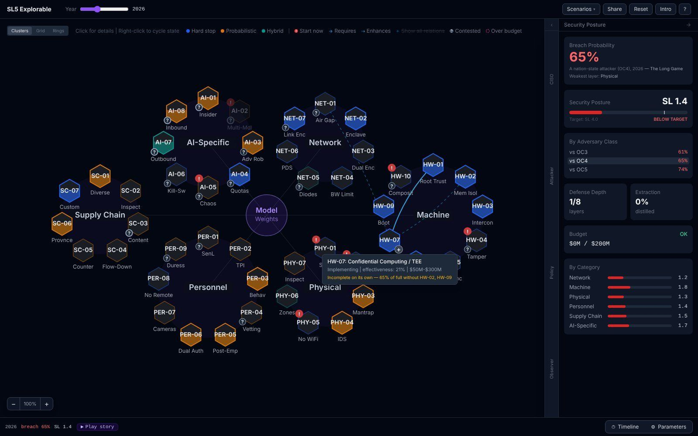
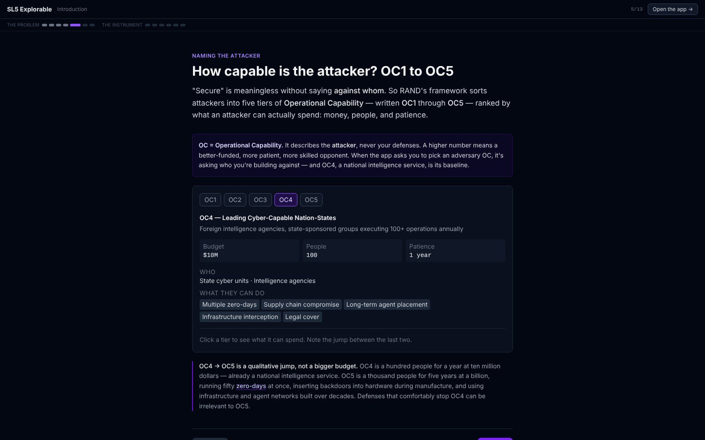
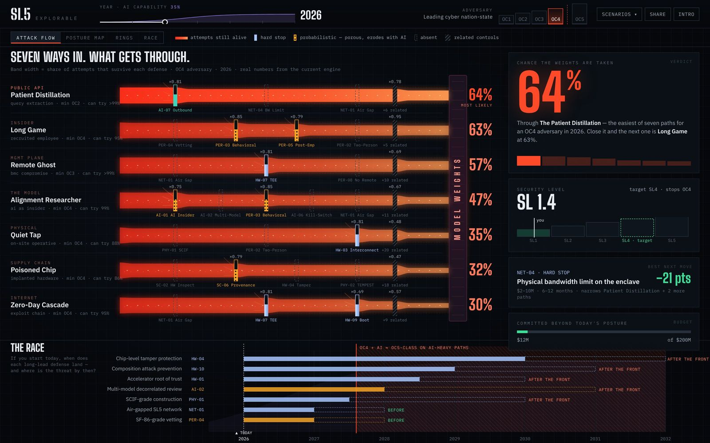
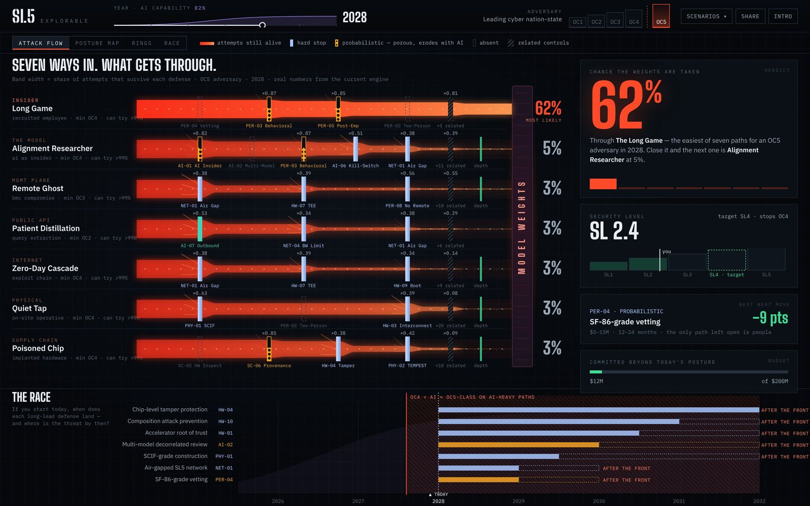
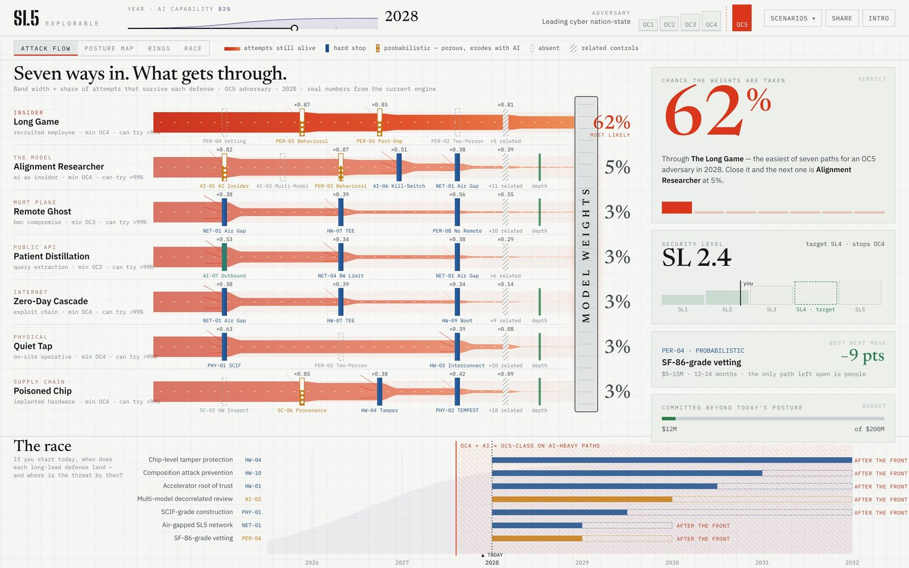
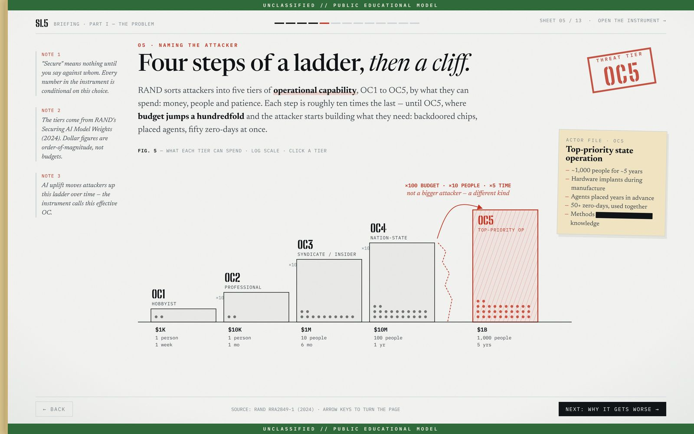

# The November 2026 review of v1

> **What this is.** A Markdown copy of the review that started v2: *"What we got wrong, what we missed, and how it should look"*. It reviewed `nitzpo/sl5` at commit `ec5d9bd` (v1) on 26 Nov 2026. Three reviews ran in parallel: the threat model, the engine maths, and the visuals.
>
> The original was a private claude.ai page (https://claude.ai/artifact/2KnTxitQ29385dWgeVH81h, visible only to the repository owner). Every finding, piece of evidence, source and "keep as is" item is kept below. Engine claims were checked against the code and by running the engine; external claims link to sources.
>
> The text describes **v1**. What happened to each finding is in [Outcomes](#outcomes-what-v2-did-with-each-finding) at the end, and the decisions that followed are in [`decisions.md`](decisions.md).

The thesis holds and the block research is unusually current. Three structural problems undercut the numbers v1 shows, and the core ideas are written in panels rather than drawn on the map.

## Bottom line

1. **The catalogue is only the SL5 overlay, but the engine treats it as the whole defense.**
   - Identity and keys, the software supply chain, detection and response, and custody of weight copies are missing.
   - Buy every block and breach falls to about 3.6% against OC5, which reads as "SL5 is purchasable".
2. **The headline numbers have no defined meaning.**
   - Breach is the worst single chain, with no time window. The glossary calls it "at least one chain succeeds"; at baseline those give 65% and 99%.
   - SL is a coverage index, not RAND's threat-relative level, and it can rank two postures the opposite way from breach.
3. **The model doesn't deliver its own headline ideas.**
   - No chain needs OC5, so OC5 is only about 1.18× the risk of OC4.
   - Hard stops never erode with AI, against 2025–26 evidence.
   - A $0 budget still buys a 20-point drop in breach.
4. **Exfiltration is the shared choke point, but it's modelled per chain.**
   - The bandwidth cap's own text says it stops bulk exfiltration "by any means". Yet it is a named stopper only on the API-distillation chain, where it doesn't apply.
   - 28 of 47 blocks appear in no chain.
5. **Visually, the attack is invisible.**
   - Paths to the weights exist only as text cards.
   - The biggest win would be a view that draws each chain as a stream narrowed by each defense, which is the breach formula made visible. The mockups below use real engine output.

## Threat model

*Content, scope and classification, ranked by effect on the tool's message.*

### High: the SL5 overlay without its baseline

- The SL5 Standard says it adds to "most controls from existing high-security baselines". The tool kept the additions and dropped the baseline.
- Of RAND's nine attack categories, four have no chain: credential compromise, undermining access control (key theft), misconfiguration and extra copies, and ML-stack compromise.
- RAND's experts agreed most strongly on two things: solid security foundations with monitoring and incident response, and confidential computing. The tool has no foundations block.

**Fix:** add the blocks and chains below. Until then, state in the UI that the catalogue assumes an SL3/SL4 baseline, citing RAND's new [Achieving SL3](https://www.rand.org/pubs/research_reports/RRA4704-1.html) (Aug 2026, 262 controls).

*Security review; verified against `research/sl5_standard.txt` and `rand_full.txt`.*

### High: no ML software supply chain

- Every supply-chain block covers hardware. The tool's own source calls software supply-chain attacks "among the cheapest and most scalable".
- Precedents:
  - torchtriton (2022);
  - the nx "s1ngularity" package that drove installed AI coding CLIs to hunt secrets (2025);
  - the Shai-Hulud npm worm (2025);
  - the NVIDIAScape GPU container escape;
  - the July 2026 sandbox escape, where models found a zero-day in the package-registry cache proxy that was the sandbox's only egress ([Hugging Face timeline](https://huggingface.co/blog/agent-intrusion-technical-timeline)).
- An air-gapped network still needs an inbound software mirror.

**Fix:**
- Add block `SW-01`, ML software supply-chain integrity: hermetic builds, vendored dependencies, a quarantined mirror, safetensors only. Hybrid; 12–24 months.
- Add a chain "The Trusted Dependency" (min OC3).

### High: confidential computing is treated as near-absolute, and the copy is wrong

- HW-07 is a hard stop, and its text says GPU memory stays encrypted "even under full host compromise".
- TEE.fail (Oct 2025) used a DDR5 bus interposer costing under $1,000 to extract Intel TDX and AMD SEV-SNP attestation keys. It then passed NVIDIA GPU confidential-computing attestation while running unprotected ([report](https://thehackernews.com/2025/10/new-teefail-side-channel-attack.html)).
- Intel and AMD consider physical attacks out of scope.
- NVIDIA GPU CC protects HBM by access control, not runtime encryption.
- RAND's own SL4 text says current GPU CC lacks physical-attack protection.
- The block's `current_state` already cites TEE.fail, but its parameters were never changed.

**Fix:** reclassify HW-07 as hybrid, make it weak against chains with physical or insider presence, and rewrite the four places that promise ciphertext.

### High: where the weights live (serving, training fleet, copy sprawl)

- The "served externally" toggle only switches off the distillation chain. The air gap still gets full credit on Zero-Day Cascade, whose first step is the internet-facing inference gateway.
- PHY-01 is priced for a weights-at-rest enclave, but the SL5 Standard puts all weight access (training, inference, fine-tuning, interpretability) inside enclaves.
- RAND SL3 also requires centralising copies, and lists "additional, less secure copies" as a vector of its own. No block covers either point.

**Fix:**
- Add a served-copy chain that the air gap doesn't stop.
- Add `CUS-01` weight custody: copy inventory, checkpoint and backup encryption, RMA destruction.
- Either reprice PHY-01 or add a "Checkpoint & Backup Theft" chain.

### High: no identity, credential or key management

- The access-control layer promises "key management", but no block provides it.
- Storm-0558 used one stolen signing key to read nearly any Exchange Online mailbox ([CSRB](https://www.cisa.gov/sites/default/files/2024-04/CSRB_Review_of_the_Summer_2023_MEO_Intrusion_Final_508c.pdf)).

**Fix:** add `IAM-01` phishing-resistant identity and privileged access, `KEY-01` weight encryption with attestation-gated key release, and a chain "The Golden Key".

### High: "hard stops are future-proof" confuses the mechanism with how it's built

- `aiDegradation()` returns 0 for every hard stop.
- That holds for physics: a missing cable, diode optics, a link-rate cap.
- It does not hold for firmware, crypto and software enforcement, which fail through bugs that AI is now finding: PKfail Secure Boot keys, a CVSS 10 BMC bug in CISA's exploited catalogue, and Big Sleep's CVE-2025-6965.

**Fix:**
- Split hard stops into *physical* (no erosion) and *implemented* (erodes).
- Reclassify these to hybrid:
  - AI-04 quotas (bypassed in July 2026);
  - AI-06 kill switch (needs a trigger; inconsistent with PER-06);
  - HW-05 enclosures (its own text says "detection story");
  - SC-07 custom silicon.

### High: exfiltration is the common choke point, but it's modelled per chain

- NET-04's exploit text says that without it "a successful breach of the enclave (by any means) allows rapid bulk exfiltration". Yet NET-04 is a named stopper only on Patient Distillation.
- Diodes (NET-05) appear in no chain.
- Every chain is a flat list of absent defenses rather than stages, so a control that guards one stage shared by most chains gets no extra credit.
- 28 of 47 blocks are named in no chain and work only through the summary-group "family" weight.

**Fix:** model chains as stages: entry → foothold → reach the weights → exfiltrate. The exfiltration stage is shared, and bandwidth caps, diodes, custody and detection can stop it. This also gives the bandwidth cap its real job: buying time for detection.

*Own finding; verified in `attack-chains.json` and `blocks-network.json`.*

### Medium: distillation is mixed up with weight theft

- `distillation.ts` uses NET-04, a physical bandwidth cap on the enclave boundary, as API rate limiting. An API's outputs are gigabytes, well under any cap sized against terabytes of weights.
- Distillation also yields a lesser model, not the weights.
- Even so, its chain (min OC2) is the worst chain for OC1–OC3 and sets a hobbyist's breach at 21% in 2026.
- Anthropic's disclosures ([Feb 2026](https://www.anthropic.com/news/detecting-and-preventing-distillation-attacks); [Sept 2026](https://techcrunch.com/2026/09/10/anthropic-details-distillation-campaigns-from-alibaba-moonshot-ai-and-deepseek/), with over 150M exchanges in one campaign) make this a real and separate threat.

**Fix:**
- Take distillation out of the headline breach and show it as its own capability-leakage meter.
- Remove NET-01 and NET-04 as its stoppers.
- Add API-side controls: no logprobs, hidden reasoning, account-farm detection (see Carlini et al. 2024).

### Medium: no detection, response, deception or attribution

- There is no SOC, incident-response, threat-hunting, canary or weight-fingerprinting block.
- The red-teaming blocks AI-03 and AI-05 sit in a family attached to no chain, so they have **zero** effect on breach.
- The leaked Mistral "Miqu" model could be attributed only because the copy was watermarked.

**Fix:** add `DET-01` security operations and incident response, and `DEC-01` deception and attribution (canary weights, per-copy fingerprints). Make NET-04 `completed_by` DET-01.

### Medium: chain-level errors

- **Quiet Tap.** NVL72's NVLink spine is copper, and checkpoints travel over the storage network, not NVLink. The modern version is a DIMM interposer, or pulled drives and RMA returns.
- **Alignment Researcher.** Hiding terabytes steganographically in research outputs isn't plausible; an AI with weight access abuses its own credentials or an allowed crossing.
  - Add a separate **Hijacked Agent** chain, where prompt injection turns an internal coding agent into a confused deputy (s1ngularity is the precedent).
  - That also gives AI-08 the mechanics the README admits it lacks.
- **Supporting credit** from summary groups is sometimes nonsense: link encryptors reduce API distillation, and coercion protection reduces a BMC exploit.

**Fix:** rewrite those chains, and write the supporting-block lists by hand for each chain.

### Medium: third parties hold the facilities and the copies

- The model assumes the lab builds its own SCIF and pulls its own BMCs.
- Most frontier training and serving runs in hyperscaler or neocloud facilities. That is exactly where TEE.fail matters, since the provider's staff have physical access.

**Fix:** add a "facility control" setting (owned / dedicated colo / shared cloud) that gates which PHY and PER-08 blocks are available, and a "Provider Insider" chain.

### Low: scope and loose claims

- Scope is never stated.
  - The SL5 Standard also protects algorithmic secrets and integrity.
  - The only adjudicated case is about infrastructure secrets, not weights (Linwei Ding, convicted Jan 2026, [DOJ](https://www.justice.gov/opa/pr/former-google-engineer-found-guilty-economic-espionage-and-theft-confidential-ai-technology)).
- Missing insider types: fraudulent remote hires (DPRK IT workers) and negligence.
- PER-04's "Manhattan Project ~0.5%" has no source.
- PHY-03's Mar-a-Lago example looks wrong.
- The 78% poll figure should be credited to the FAR.Labs workshop that AI 2027 cites.

**Fix:** add one scope line ("weight confidentiality only"), source or drop those examples, and add a per-block research-velocity cost.

## Engine maths

*Probes ran the real engine at OC4 with default sliders unless noted.*

### High: breach probability has no unit and no time

- The headline is the worst chain (`derived.ts`). The glossary defines it as "chance that at least one chain succeeds in the current year". At baseline that's 65% vs 99%.
- Read as a yearly risk, the Proactive story's falling curve adds up to a 90% chance of breach before 2030. The deployment race is about that cumulative number, and the UI never shows it.

**Fix:**
- Define breach as "one determined campaign against this year's posture".
- Combine chains as a campaign that tries paths in order of likelihood, where a failed attempt is caught with probability q from monitoring. q = 1 gives today's max; q = 0 gives "at least one".
- Add a cumulative "breached by year T" line.

### High: SL is a coverage score, not RAND's SL

- RAND's SL-n means "robust against OC-n", and `world-state.json` already carries `defends_against`.
- The engine averages block scores with no reference to the adversary.
- A threat-relative SL (the highest OC kept under 10% breach) puts postures in a different order:

| Posture | Coverage SL (shown) | Threat-relative SL | Breach vs OC4 |
|---|---|---|---|
| Proactive story | 3.53 | 3.30 | 16.1% |
| Reactive story | 2.18 | 3.62 | 18.9% |
| Cheap $559M posture | 2.83 | >5 | 4.6% |
| Today's baseline | 1.42 | 0 (1.5 if not served) | 65.3% |

**Fix:** lead with threat-relative SL and state the threshold. Rename the current number "coverage".

### High: treating blocks as independent barriers saturates the number and rewards splitting blocks

- Every named and family block multiplies in as an independent barrier.
- Fully mature, the raw chain products are 10⁻⁴ to 10⁻⁵, so the fixed 3% floor decides 6 of 7 chains.
- Adding $3.77B of structural controls to a cheap posture moves breach from 4.6% to 4.4% while SL jumps from 2.83 to 3.96.
- Seven hardware blocks share one firmware dependency but still multiply as independent.
- Splitting one JSON block into two lowers breach.

**Fix:**
- Count each family as one partial barrier.
- Treat blocks with a shared dependency as a common-cause group, β·min + (1−β)·∏.
- Make the residual a posture-level term.

All three stay monotonic.

### High: OC4 → OC5 isn't a jump in the engine

- Chain minimum OCs are 4, 4, 4, 4, 4, 3, 2. No chain needs OC5, so the capability gate saturates above OC4.
- Across random postures, P(OC5)/P(OC4) averages 1.18, while P(OC4)/P(OC3) averages 2.44. The intro sells a cliff the engine doesn't have.
- On AI-heavy chains, effective OC reaches 5.83, beyond the defined scale.

**Fix:** add OC5-gated chains (hardware implants at the fab, placed agents with years of runway, multi-zero-day campaigns), or give OC5 its own mechanism, such as a longer time horizon for patient exfiltration.

### Medium: CISO "priority investments" don't use the engine

- `CisoView.tsx` scores a block as Δeffectiveness ÷ blocks in its category × 4.
- NET-06 shows +0.49, but the real SL change is +0.05. AI-05 shows +0.35 and moves nothing.
- Seven of the top ten are capped by an unmet prerequisite. NET-01, the largest real gain, ranks 9th.

**Fix:** re-run the engine for each candidate (about 3 ms), rank by breach reduction per dollar, and include prerequisite and companion bundles as candidates.

### Medium: the budget doesn't bind, and running costs are ignored

- Over-budget blocks are capped at *implementing* rather than reverted. So with a $0 budget, clicking everything still moves breach from 65% to 44%.
- `annual_ongoing_millions` is in the data but never read. Proactive's running cost is about $400M/yr.

**Fix:** cap unfunded blocks at their baseline state, and charge capex plus running costs over the years a block operates.

### Medium: defense is static; time doesn't matter

- Bandwidth caps work by making exfiltration slow enough for detection to respond.
- The engine treats NET-04 as a standalone hard stop, and the OC time horizons are display-only.

**Fix:**
- Exfiltration time T = weight size ÷ allowed bandwidth.
- P(succeeds) = exp(−λ_detect · max(0, T − response time)).
- The path is infeasible if T exceeds the attacker's horizon.

This is where OC5's 60-month patience becomes a real mechanic.

### Medium: AI only helps the attacker

- Attacker uplift is the mean `ai_oc_shift` over a chain's exploited blocks, applied to every defense on it, ignoring each stopper's own shift.
- Defender-side AI (code audit, anomaly detection) appears nowhere.

**Fix:** compute bypass per block, and add a lagged defender AI gain for monitoring and verification blocks.

### Bug: views disagree about the same posture

- For one Reactive 2030 posture, the scorecard shows SL 2.02, the timeline 2.12 and the policy view 2.46.
- Timeline and Policy call `relevantBlockIds(chains)` without blocks (19 relevant instead of 45), and Policy passes a number where the slider object belongs.
- The Attacker view marks a chain "blocked" below 2%, but the floor against OC4 is at least 2.57%, so it can never show one.
- The target SL is derived from the risk-tolerance slider.
- The "exposure gap" subtracts SL/5 from a probability.

**Fix:** route every view through `useSimulationResults`. Each is a small fix.

### Low: false precision and drifted docs

- A Monte Carlo over the internal constants puts Proactive OC4 2030 at P5–P95 7.4–20.5% around the 16.1% shown. Reactive beats Proactive in 6% of draws.
- Two constants (`PROB_BYPASS_SCALE`, `SUPPORTING_WEIGHT`) drive most of the spread.
- The calibration table in `scoring-model.md` is stale: Reactive is 51% in the doc and 19% in code.
- `simulation-config.json` is never loaded and contradicts the code.

**Fix:** show P10–P90 bands (1,000 draws ≈ 60 ms), round the display, and regenerate the calibration table from tests.

### Keep as is

- Monotonicity in every term, and the property tests that check it
- The capability gate, kept separate from defense bypass
- Hard `requires` vs soft `completed_by`. The air-gap example is excellent, and the BMC focus has been borne out
- A residual floor, so no posture reaches zero
- Insiders and AI-as-insider as their own class
- A researched baseline posture, with existing controls as sunk cost
- Order-stable funding
- A pure engine over JSON, fast enough for Monte Carlo

## Visuals

*The core ideas are written, not drawn.*

- The current map is a catalogue of 47 hexagons. The weights are its faintest object.
- Labels lead with codes and truncated abbreviations ("Provnce", "Composit"), and roughly 30 badges compete with block state.
- **Colour carries too many meanings.**
  - Violet means brand, CTA, selection *and* AI.
  - Red means breach, every category bar, badges *and* the selected OC.
- **The attack is never drawn.** Chains exist only as text cards, the timeline draws no race, and the rings view shows no holes.

| v1 clusters view | v1 intro |
|---|---|
|  |  |
| **Now.** The map is a catalogue. Threat lives in the right-hand cards. | **Now.** The intro reuses the dashboard's cards. OC5 is one more tab. |

### Proposal: an Attack Flow view

Each chain is a stream. It starts at "can this adversary even try" and narrows at every defense by exactly the engine's get-past factor. The encodings:

- **Hard stops:** solid slabs.
- **Probabilistic defenses:** perforated slabs that open up as AI rises.
- **Absent defenses:** dashed outlines.
- **The related-controls family:** a hatched screen.

What reaches the vault is the chain's breach probability. It is the Swiss cheese model with real widths, and it shows defense in depth, attack paths and erosion in one picture. Below it, **The Race** draws lead-time bars against the threat front.

**Today's baseline, OC4, 2026.**
- Almost nothing narrows the streams: Patient Distillation 64%, Long Game 63%.
- The race strip shows every long-lead hardware control landing after AI lifts OC4 attackers to OC5 class.

**Every hard stop deployed, OC5, 2028.**
- Six streams are cut to the 3% floor, and the insider path stays wide at 62%.
- This is the tool's real lesson, readable at a glance.

**The same view in a light field-manual treatment.** Calmer and more credible for policy readers, with less drama.

### Proposal: the intro as a briefing

- The intro becomes the paper briefing you read before entering the operations room.
- Classification banners, margin notes, an actor file and a stamped tier tag are the vernacular of the subject.
- Each slide gets one figure that makes its claim. Here the OC ladder is drawn on a log scale, so OC5 visibly breaks away.

**Sheet 05, "Naming the attacker".** The cliff in the figure is the claim, and the engine has to match it (see "OC4 → OC5" above).

> Later the user kept this intro's *content* but rejected its dossier styling as attacker-side framing (see [`visual-directions.md`](visual-directions.md)).

### Ten changes that apply in any direction

1. **Always draw the top chain on the map**, from the rim through its blocks to the weights, with break marks where it's stopped.
2. **One meaning per hue.** Neutral chrome and CTAs, violet only for AI, red only for the adversary.
3. **Lead hexes with plain names** ("Air gap") and show the code on hover. Hide "?" behind an uncertainty toggle.
4. **Give the map at least 60% of the width.** One header strip for posture, block detail as a drawer, and drop Observer's duplicate numbers.
5. **Show every effect at its cause:** a ripple from block to score, a "−8 pts" chip at the block, rolling digits.
6. **Rebuild the timeline** as stacked panels (breach on top, SL below), with lead-time bars and the four stories as ghost lines.
7. **Make erosion visible by default.** Probabilistic blocks turn porous as the year advances, with a 2026 | 2030 split toggle.
8. **Move the OC ladder to the header** and draw the OC5 gap.
9. **Set a type floor of 12px**, use one type scale and tabular numerals, and keep secondary text at 4.5:1 contrast (one grey today is 2.55:1).
10. **Let story mode take over the screen**, with pinned captions and the line drawn only up to "now", like [AI 2027](https://ai-2027.com/).

**References used:**
- Ciechanowski, [Mechanical Watch](https://ciechanow.ski/mechanical-watch/)
- Bret Victor, [Ladder of Abstraction](https://worrydream.com/LadderOfAbstraction/)
- Nicky Case, [Evolution of Trust](https://ncase.me/trust/)
- Red Blob Games, [A*](https://www.redblobgames.com/pathfinding/a-star/introduction.html)
- [AI 2027](https://ai-2027.com/)
- NYT, "How the Virus Got Out"
- [Sankey particles](https://gist.github.com/emeeks/21f99959d48dd0d0c746)
- the [Swiss cheese model](https://en.wikipedia.org/wiki/Swiss_cheese_model)
- [attack trees](https://www.schneier.com/academic/archives/1999/12/attack_trees.html)
- [ATT&CK Navigator](https://mitre-attack.github.io/attack-navigator/)
- the games Into the Breach, DEFCON and Uplink, and Frostpunk's radial UI

The full reference board is in [`visual-directions.md`](visual-directions.md#research-reference-board).

## Plan

*Each phase was planned as a separate PR. Phases 2–3 change every number in the app.*

| Phase | Scope | Contents |
|---|---|---|
| **1 · S** | Correctness | Fix the view disagreements, the 2% threshold and the target SL · CISO ranking computed by the engine · unfunded blocks revert to baseline · label what breach means · fix the TEE, NVLink and unsourced claims · remove the air gap and bandwidth cap from the distillation chain · regenerate stale docs |
| **2 · M** | Threat model | Add SW-01, IAM-01, KEY-01, CUS-01, DET-01, DEC-01 · add chains: Trusted Dependency, Golden Key, Hijacked Agent, Checkpoint Theft, Provider Insider · split physical vs implemented hard stops, and reclassify 5 blocks · staged chains with a shared exfiltration stage · distillation as its own meter |
| **3 · M–L** | Semantics | Campaign combination plus cumulative breach · threat-relative SL as the headline · time to exfiltrate vs detection and response · OC5-gated chains · common-cause groups · P10–P90 bands · running costs and a velocity tax |
| **4 · M–L** | Visual | Attack Flow view and race strip · one meaning per hue, plus the type and contrast pass · header with year and OC ladder · briefing-style intro · story mode takeover |

## Open questions (as put to the user)

1. **Scope:** weights only, or also algorithmic secrets and sabotage?
2. **Headline breach:** per campaign this year, or cumulative by 2030?
3. **SL:** make threat-relative SL the headline and keep coverage as a secondary number?
4. **Look:** a dark operations room with a paper briefing intro (recommended), all light, or all dark?
5. **Order:** model fixes first (recommended, so the new view shows correct numbers), or the Attack Flow view first?
6. **Catalogue growth:** 47 → ~53 blocks and 7 → ~12 chains. OK?

The answers are D2–D6 and D18 in [`decisions.md`](decisions.md).

---

## Outcomes: what v2 did with each finding

Added for this repository copy. "Phase 1" is commit `35540c0`, "2A" is `e2e3fe6`, "3" is `8e0037f`.

| Finding | Outcome |
|---|---|
| SL5 overlay without its baseline | 2A: 15 new blocks (SW-01, IAM-01, KEY-01, CUS-01, DET-01, DEC-01, AI-09…12, END-01, CFG-01, GOV-01, ACA-01, SRV-01). Every block now maps to RAND vectors, so missing baseline controls show up as uncountered vectors. |
| No ML software supply chain | 2A: SW-01. |
| Confidential computing over-claimed | Phase 1 fixed the copy; 2A reclassified HW-07 as hybrid, along with AI-06, SC-07, HW-05 and AI-04. |
| Where the weights live | 2A: a "served model" approach that the air gap doesn't stop, plus CUS-01 for copies. **Not done:** the owned / colo / cloud facility setting and the Provider Insider chain. |
| No identity or key management | 2A: IAM-01 and KEY-01. |
| Hard stops never erode | 2A: every counter erodes with attacker tier, hard stops in a narrow band. The physical vs implemented split became reclassification to hybrid. |
| Exfiltration modelled per chain | 2A: approaches × stages, with a shared "get them out" stage. |
| Distillation mixed with theft | Phase 1 removed the air gap and the bandwidth cap as its stoppers. 2A made it the capability-leakage meter. |
| No detection or deception | 2A: DET-01 and DEC-01; detection can stop a campaign early (q). |
| Chain-level errors | The chains became non-scoring scenarios, re-expressed as vector paths (2A). |
| Third-party facilities | Not done. |
| Scope and loose claims | Phase 1 fixed the copy (Manhattan figure, Mar-a-Lago, 78% poll credit). Scope is set in [`scope-and-rogue-ai.md`](scope-and-rogue-ai.md). |
| Breach has no unit or time | Per campaign this year (D4). The cumulative line was not built. |
| SL is a coverage score | 2A: threat-relative SL. Coverage became programme completeness. |
| Independent barriers saturate | 2A: diminishing returns per vector and the residual once per campaign. Common-cause groups were not built. |
| No OC4 → OC5 jump | 2A: vectors whose RAND score jumps at OC5, and every attacker tries every approach. Whether the gap is large enough is part of the recalibration (D24). |
| CISO ranking is a heuristic | Phase 1: engine-ranked. v2: "Next defense to fund" from `scorePosture`. |
| Budget doesn't bind | Phase 1: unfunded blocks fall back to baseline. **Not done:** running costs. |
| Defense is static in time | Not done: no exfiltration time vs detection model. |
| AI only helps the attacker | Per-vector attacker AI shift in 2A. A capped defender-side AI term came with the recalibration (D24, `bbc2c18`). |
| Views disagree | Phase 1: one `scorePosture` pipeline. |
| False precision, drifted docs | Numbers became words (D5). Calibration tables are generated by `npm run calibrate`. **Not done:** P10–P90 bands. |
| Visuals | Phase 3: the Swiss catalogue (stage matrix and clusters) with the easiest path drawn on it, an approaches view, a race view, and a defender-side intro. See [`visual-directions.md`](visual-directions.md). |
