# Visual directions explored for v2

Every look and layout considered for v2, the scores they were compared on, what the user said, and what shipped. The images are mockups built from real v1 engine output and real block data. They are compressed copies; the HTML mockups that produced them were not kept.

The comparison page shown to the user was a private claude.ai artifact (https://claude.ai/artifact/MmfzgFFbzfHuZ8HKWkh9kF, visible only to the repository owner); its content is reproduced below.

**Outcome in one line:** the **Swiss signal** look, with the **catalogue as the main screen** in two views (a **stage matrix** and **evolved clusters**). Attack paths are drawn on top of the catalogue, and an approaches "lanes" view sits as a second tab. Every label is written from the defender's side.

## Why the visuals changed

The visual research (26 Nov) found v1's core ideas were written in panels rather than drawn:

- attack paths existed only as text cards;
- the weights were the faintest object on the map;
- violet and red each carried four or more meanings;
- labels led with codes ("NET-07") and truncated abbreviations;
- about 30 badges competed with block state;
- the map got about 40% of the width;
- the timeline drew no race;
- the OC4 → OC5 jump read as three nearly identical red numbers.

The full critique and the "ten changes that apply in any direction" are in [`2026-11-review.md`](2026-11-review.md#visuals).

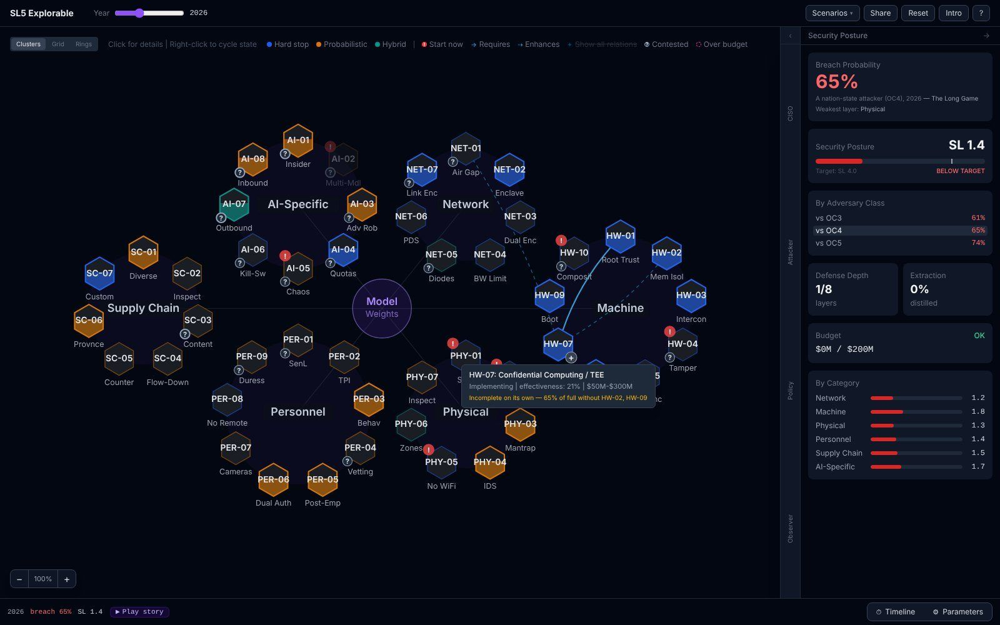

*v1's clusters view, 2026 baseline.*

## Round 1: attack-flow lanes (in the review, 26 Nov)

The review proposed an **Attack Flow** view, mocked in two looks:
- one lane per chain;
- each lane narrows at every defense by the engine's get-past factor;
- hard stops are solid slabs, probabilistic defenses perforated slabs, absent defenses dashed outlines.

### Ops room (dark)

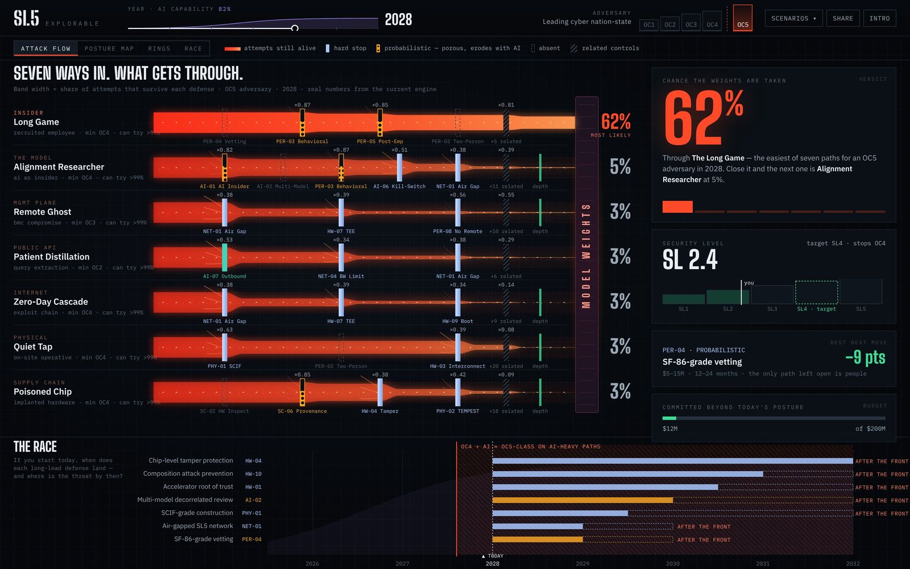

A dark tactical instrument with glowing streams; Big Shoulders and IBM Plex. The review's own recommendation at the time was this look plus a paper briefing intro.
- **Works:** it feels like a live instrument and is the smallest change from v1's dark UI. Particles flowing along the streams would animate well.
- **Watch:** "cyber war room" is a cliché with a hype tone. Dark, glow and small mono text hurt legibility.

### Field manual (light)

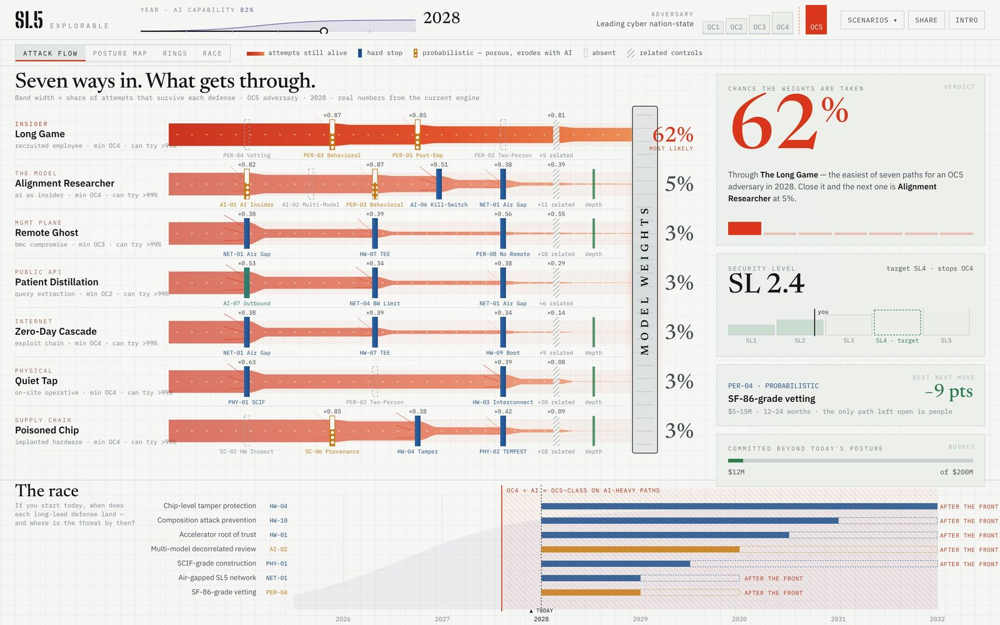

Editorial print: serif display, calm paper, vermilion threat; Newsreader and IBM Plex.
- **Works:** the most credible, report-like tone. The tapered streams show attrition smoothly.
- **Watch:** serif-on-paper with a red accent is a common AI-design look, and there is no choke-point view.

### Briefing intro

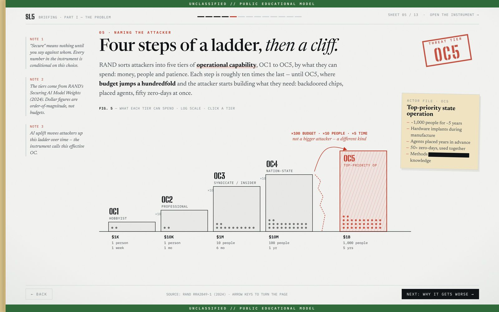

The intro as "the paper briefing you read before the instrument": classification banners, margin notes, an actor file and a stamped tier tag. Each slide has one figure that makes its claim; here the OC ladder is on a log scale, so OC5 visibly breaks away.

## Round 2: four more directions (26 Nov)

The review asked which look to use. User: "Let's think of more alternatives and compare all the alternatives". Four more directions were mocked on the same data (OC5 in 2028, every hard stop deployed). Each designer was briefed separately.

### Swiss signal (lanes, light)

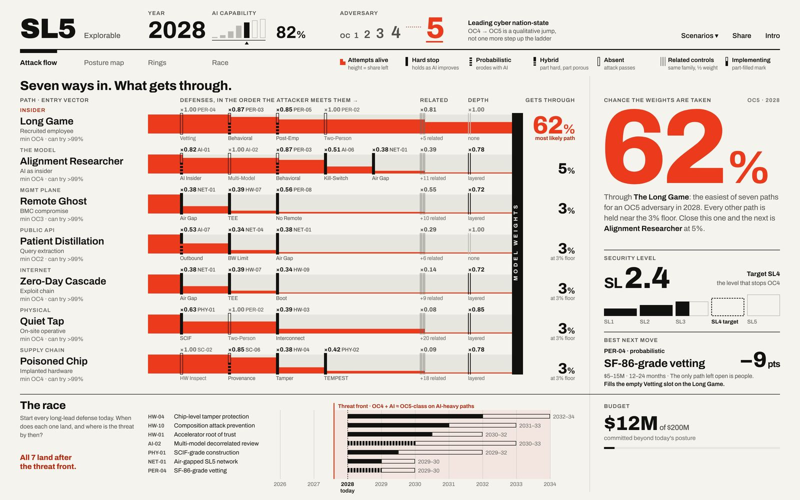

International Typographic Style: one signal colour for the adversary, and shape for defense type; set in Archivo.
- **Works:** the verdict reads in under five seconds. Solid, perforated and empty marks need no legend after one look. Slots line up across paths, so the grid scales.
- **Watch:** the ×factor labels are dense (they became band words), floor-level bars are 2px hairlines, and it is less "live instrument", more briefing page.

### Transit map (network, light)

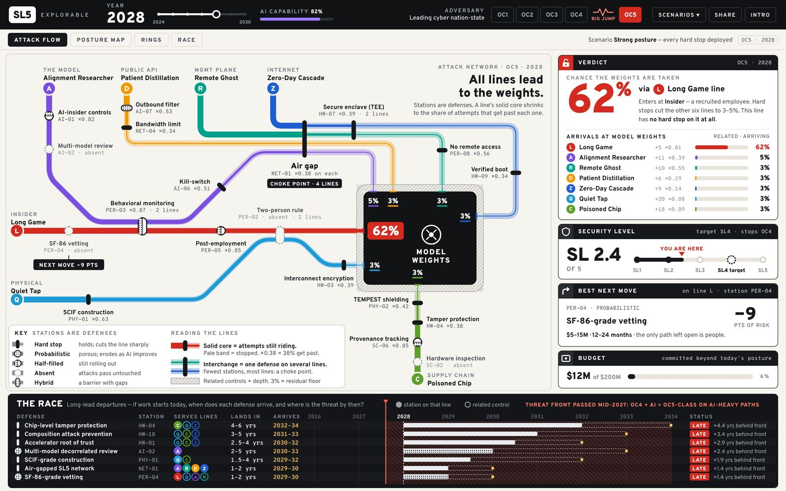

Paths as lines and defenses as stations, so a shared defense becomes an interchange; set in Overpass.
- **Works:** the only direction that shows choke points ("the air gap guards 4 lines"). The arrivals and departures boards for the race are instantly familiar. The Long Game reads as the one straight, unbarred line.
- **Watch:** the layout is hand-placed, so every new path means re-layout (L effort). Seven or more line colours strain colour-vision separation. "Good service" for the attacker is an odd frame.

### Blueprint (lanes, light)

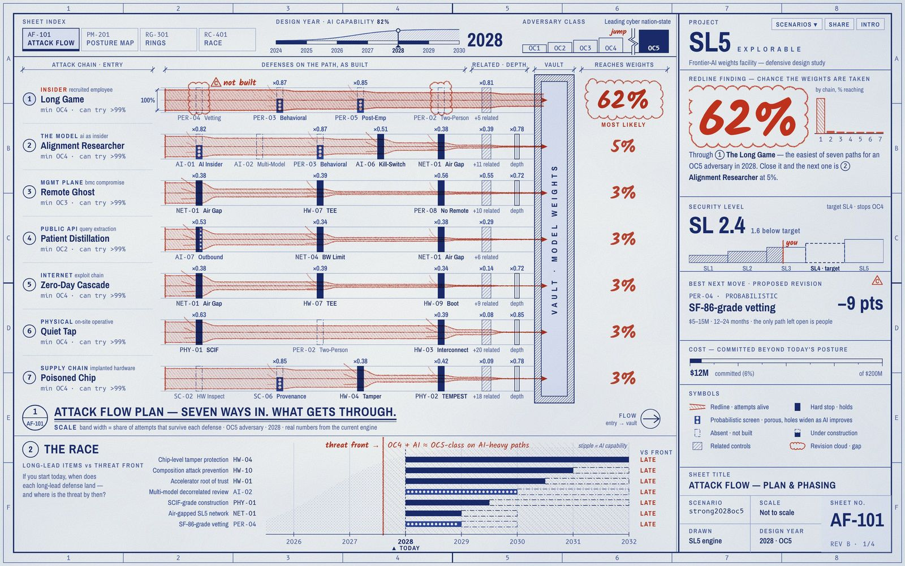

A whiteprint drawing sheet, with attacks as red-pencil markups on your facility design; set in Archivo Narrow, B612 Mono and Kalam.
- **Works:** the metaphor is literal (you are designing a secure facility). Revision clouds on unbuilt walls point at the gap. The race reads as a construction schedule.
- **Watch:** hard and probabilistic defenses differ only by shape and shade. The handwritten font can tip into kitsch. The sheet-index decoration adds noise.

### Tabletop wargame (board, light on dark)

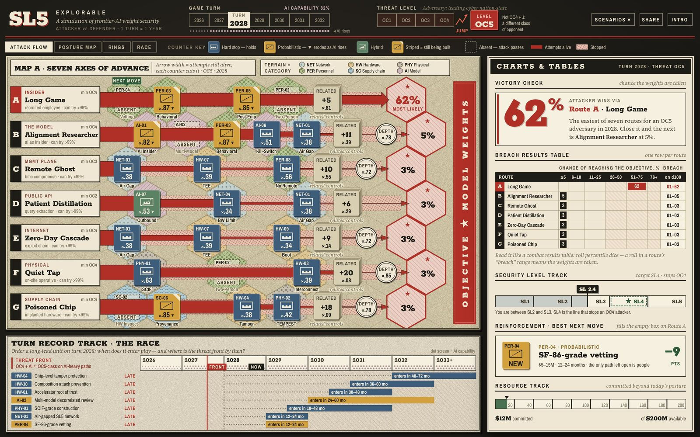

A 1980s hex-and-counter wargame: counters, a combat results table, a turn track; set in Rokkitt, Archivo Narrow and Source Serif.
- **Works:** national-security people actually wargame, so the vernacular is earned. The results table is natively banded, a good fit for vague numbers. Counters make defense type tangible.
- **Watch:** the densest option, with small text on textured terrain. "Victory" and dice can read as gamifying theft. Terrain tints rely on colour alone.

### Comparison of the path view

Five dots is best. The ratings are the agent's judgement from the mockups and the designers' notes. "Scales" means it still works at the planned ~12 paths and ~53 defenses.

| Direction | Glance test | Shows the ideas | Choke points | Tone for policy | Accessibility | Scales | Fits vague bands | Distinctive | Effort |
|---|---|---|---|---|---|---|---|---|---|
| **Swiss signal** | 5 | 4 | 2 | 5 | 5 | 5 | 4 | 3 | M |
| Transit map | 5 | 4 | 5 | 4 | 3 | 2 | 4 | 4 | L |
| Blueprint | 4 | 5 | 1 | 4 | 3 | 4 | 3 | 5 | M |
| Wargame | 3 | 5 | 2 | 3 | 3 | 3 | 5 | 5 | M–L |
| Field manual | 4 | 4 | 1 | 5 | 4 | 4 | 3 | 2 | M |
| Ops room | 4 | 4 | 1 | 3 | 3 | 4 | 3 | 3 | S–M |

The agent recommended Swiss signal as the base system, borrowing three devices from the others:
- from the transit map, shared defenses lined up in labelled columns ("Air gap · 4 paths"), so choke points read at once;
- from the wargame, the banded results table;
- from the blueprint, revision clouds on the open doors of the leading path.

Blueprint was the runner-up "if you'd rather be memorable than neutral".

## The mistake: "Where is the catalog?"

Rounds 1 and 2 mocked only the attack-flow view. The user replied:

> "But you only designed the view with the lines per attack story. Where is the catalog? I think you missed the point"

The catalogue, the posture builder where users click blocks and watch the threat respond, is the app's **main screen**. Judging looks on a secondary view gave a misleading comparison. Round 3 was briefed to mock the catalogue first. The brief required each block to show:
- its plain name, with the code secondary;
- its defense type by form;
- all five states;
- whether it lies on a leading attack path;
- AI erosion;
- a "start now" mark for long-lead blocks.

The brief also required ghost tiles for the coming Phase-2 blocks, a verdict rail in words with no percentages, and the attack paths drawn *on top of* the catalogue. See [`process-and-lessons.md`](process-and-lessons.md) for the lesson.

## Round 3: the catalogue first (27 Nov)

The same posture in all three: the 2026 baseline plus three moves (air gap under way, no remote access and verified boot deployed), against OC4, with the two leading attack routes traced. The real choice was **what a block's position means**.

### Stage matrix (recommended)

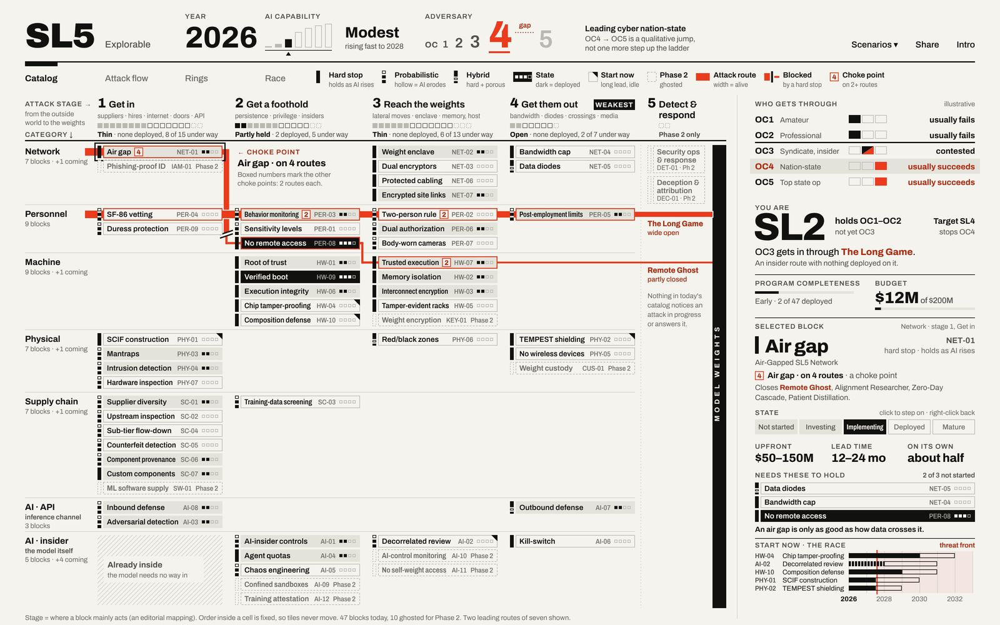

Columns are attack stages and rows are categories, like the MITRE ATT&CK Navigator.
- **Works:**
  - an empty column is an open stage, and "Get them out" is visibly the weakest; that is the exfiltration choke point from the review, now visible without reading;
  - routes read left to right like a sentence;
  - "AI · insider" has a hatched "already inside" entry cell, so the rogue-AI threat has a natural home;
  - the grid scales to about 70 tiles.
- **Watch:** each block needs a stage (about 8 placements were debatable), and a block sits in one column only. Showing all routes at once clutters.

### Facility floor plan

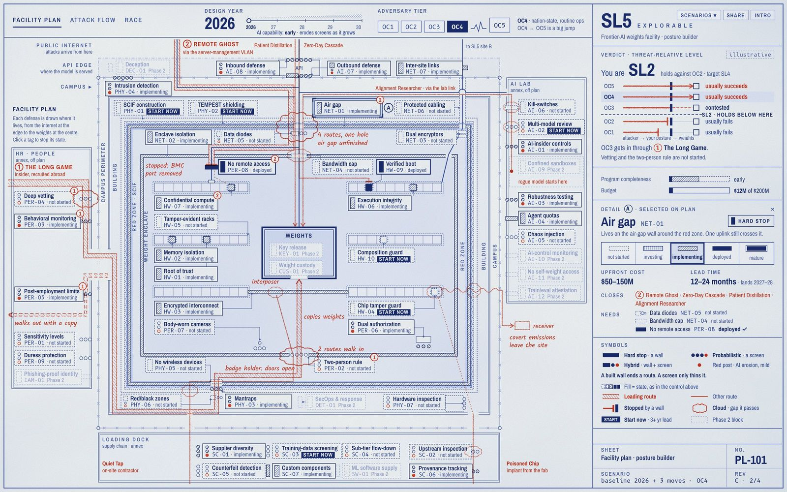

The facility you are designing: nested walls from the internet to the vault, with HR, AI-lab and loading-dock annexes.
- **Works:** defense in depth is literal, the insider story is legible, and choke points are obvious.
- **Watch:** the densest option. Every block is hand-placed (L effort), which is brittle as the catalogue grows. Cyber and people controls have no natural place.

### Evolved clusters

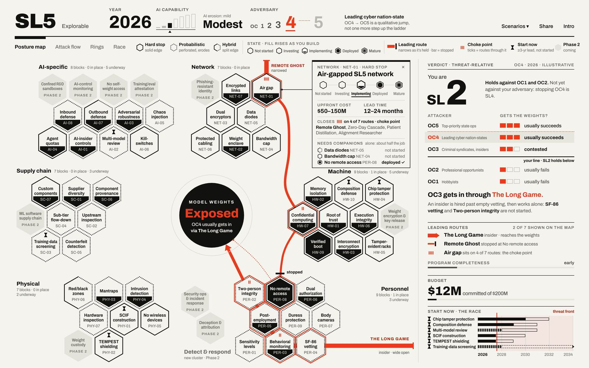

v1's six category clusters around the weights, re-encoded with plain names, fill for state and red route bands.
- **Works:** familiar; the weights disc carries the verdict; the lowest-risk change.
- **Watch:** position says nothing about the attack, so routes zigzag, and the weak exfiltration stage stays hidden.

### Comparison of the catalogue layouts

| Layout | Position means | Verdict at a glance | Routes readable | Choke points | Weakest stage visible | Scales to 60+ | Distinctive | Effort |
|---|---|---|---|---|---|---|---|---|
| **Stage matrix** | Where in the attack it acts | 5 | 5 | 4 | 5 | 4 | 4 | M |
| Facility plan | Where it physically lives | 4 | 3 | 5 | 3 | 2 | 5 | L |
| Evolved clusters | Its category only | 5 | 3 | 3 | 1 | 4 | 3 | M |

The agent's recommendation:
1. the stage matrix as the main screen, in the Swiss style;
2. the attack paths as a secondary view;
3. the facility plan kept as an idea for the intro or a later "physical layer";
4. retire v1's Grid and Rings views.

## The user's decisions (27 Nov)

> "Stage matrix is pretty good, but maybe also the evolved clusters. maybe we should have both views available"
>
> "Facility plan is nice in theory but i would completely skip it"
>
> "THe designs later a bit too catchy, but the first one (the recommended) is decent"
>
> "the new breifing intro is cool in it's CONTENT, but i don't like this style too much … remember that the simulator is for the defenders to plan defences, not plan attacks..."

- **Look:** Swiss signal. Transit, blueprint, wargame and ops room were "a bit too catchy".
- **Main screen:** both the stage matrix (default) and evolved clusters, behind a toggle.
- **Facility plan:** dropped ("completely skip it").
- **Intro:** keep the briefing's *content* (one claim and one figure per slide, the OC ladder with the OC5 cliff), drop the dossier styling. Classification banners, actor files and stamps frame the user as the attacker. The audience is defenders and policymakers planning defenses.

## What was specified (Phase 3)

From the Phase 3 build spec, approved as the design direction:

- **Colour:**
  - light paper `#F4F3EE`, ink `#111110`, secondary inks `#52514C` and `#6B6A64`, rule `#D5D4CD`, "stopped" tint `#E6E5DE`;
  - **one signal red reserved for the adversary and threat**: `#EB3A1C` for large marks, `#B8260C` for small text;
  - an optional deep green `#1F6B46` for "your posture / target";
  - AI shown in ink with a hatch, not violet;
  - a deliberate dark palette from the same tokens.
- **Type:** Archivo for everything, IBM Plex Mono for codes; tabular numerals; scale 12/14/16/20/28/44/72; nothing below 12px.
- **Encodings:**
  - defense type by shape: hard stop = solid bar, probabilistic = perforated, hybrid = split;
  - state by fill: empty outline, tip, lower third, full, full plus inner hairline.
- **Layout:** a strict flush-left grid; no shadows, glow or rounded cards; hierarchy from scale and weight.
- **Words, not numbers:** per-tier *usually fails / contested / usually succeeds*, and SL as a level plus a progress bar.
- **Defender vocabulary:** "Where you're exposed", "Approaches still open", "Next defense to fund", "What still gets through". Never "Attack flow", "Seven ways in", "victory", dossiers or stamps.

## What shipped in v2 (Phase 3, commit `8e0037f`)

| Stage matrix (default) | Evolved clusters |
|---|---|
| 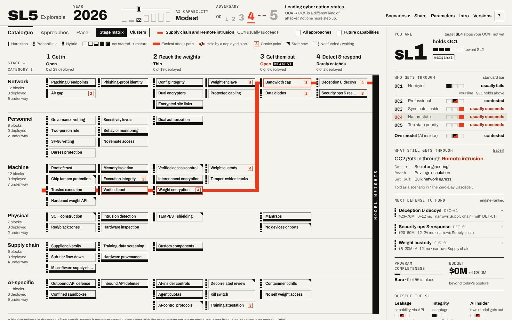 | 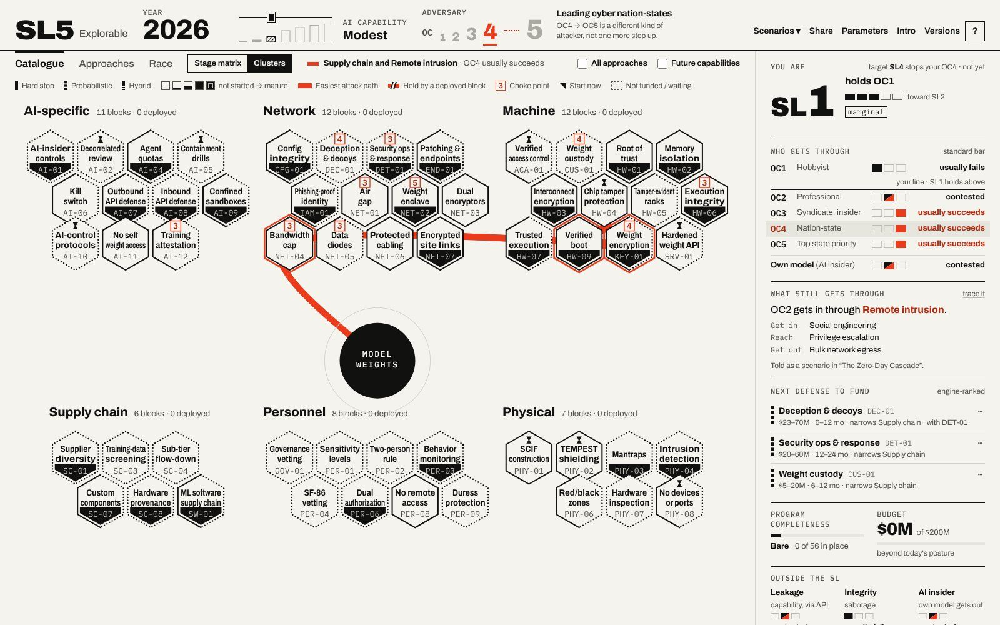 |
| **Approaches view** | **The Proactive story at 2030** |
| 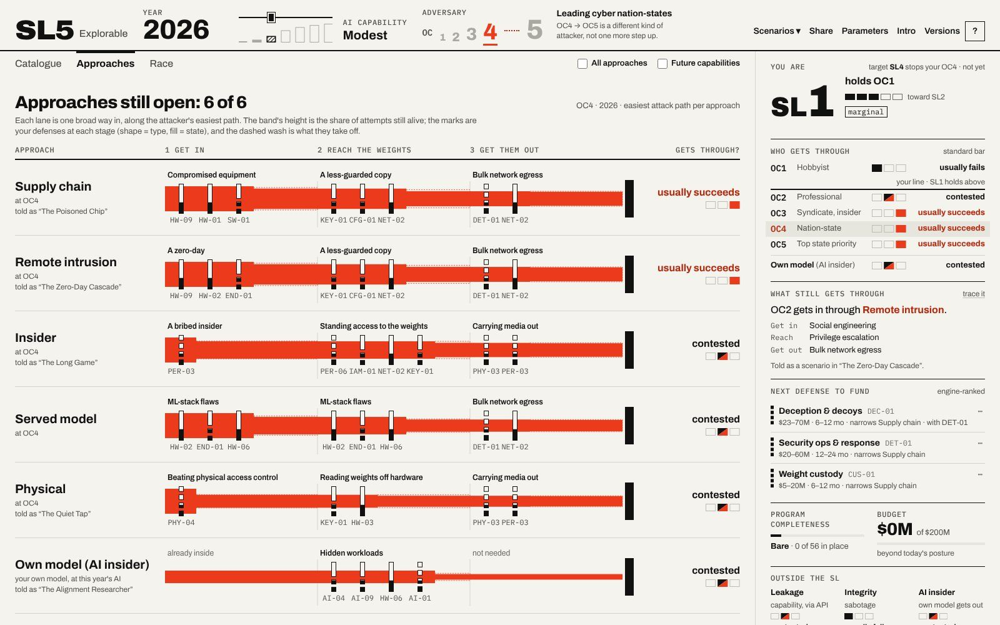 | 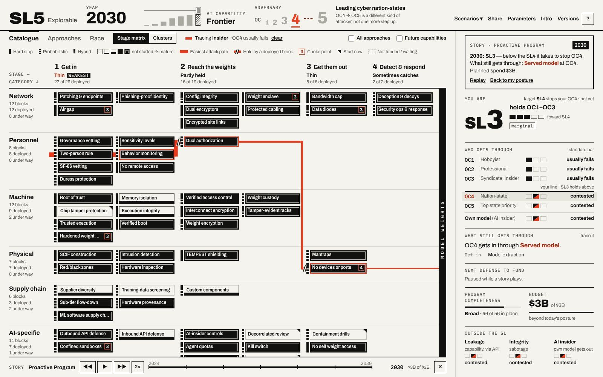 |
| **Defender-side intro** | **Version picker at /sl5/** |
| 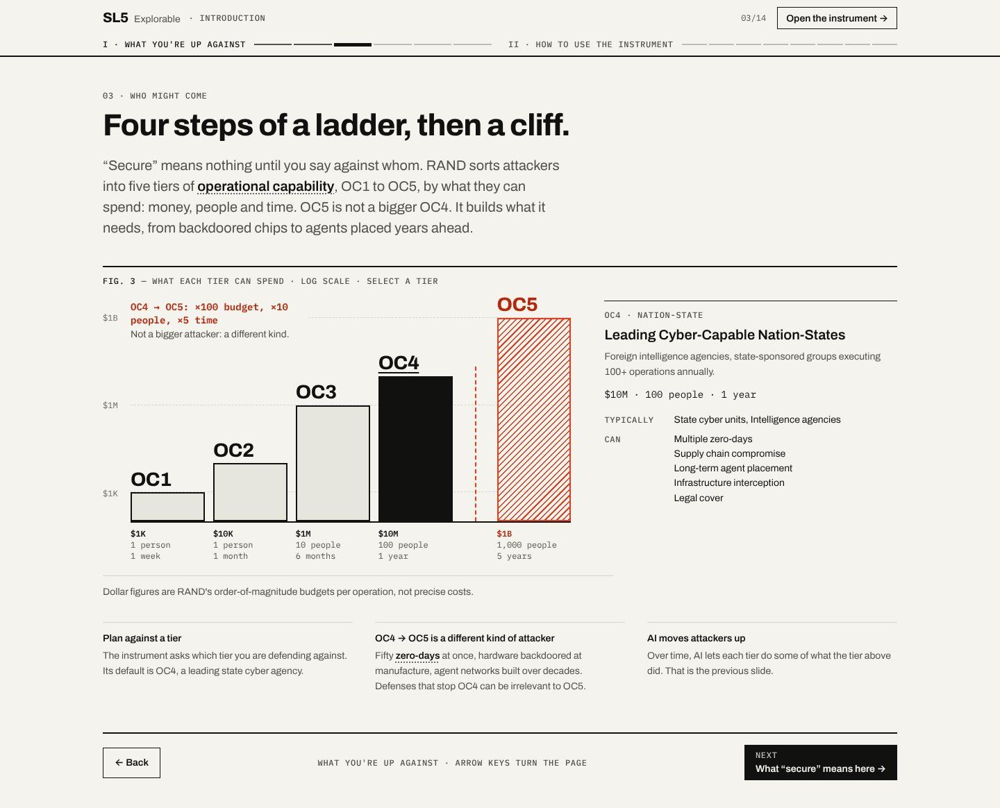 | 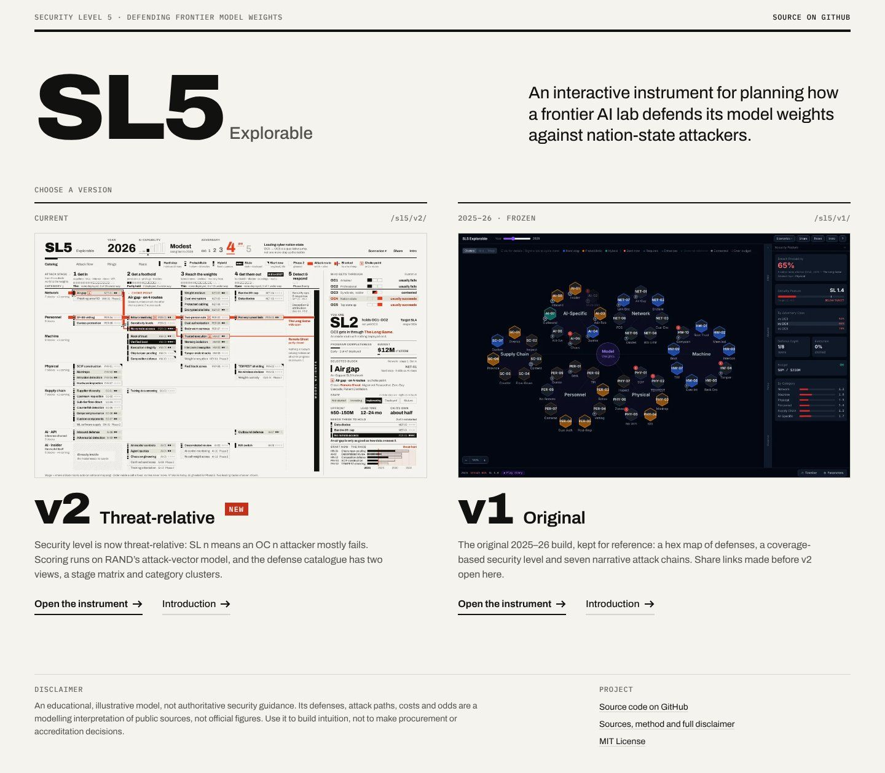 |

*Screenshots of the first v2 release, before the 28 Nov recalibration; the verdicts shown predate it.*

## Considered and dropped without a mockup

- **Phosphor terminal.** Green-on-black CRT, Uplink-style. The most clichéd "hacker" look, with poor legibility for long sessions.
- **Living organism / immune system.**
  - The concept: the weights as a nucleus, membranes as layers, attacks as pathogen particles.
  - Beautiful, but it trivialises the subject, and 47 discrete controls don't map to tissue.
- **Satellite site plan.** Annotated aerial imagery of a datacentre campus. Strong for the physical layer only.

## Research reference board

The visual research looked at these for techniques. They are cited, not copied.

| Reference | Technique borrowed or considered |
|---|---|
| Ciechanowski, [Mechanical Watch](https://ciechanow.ski/mechanical-watch/), [GPS](https://ciechanow.ski/gps/) | Show one part alone, show it failing, add the fixing part; links in the prose set the figure's state |
| Bret Victor, [Ladder of Abstraction](https://worrydream.com/LadderOfAbstraction/), [Explorable Explanations](https://worrydream.com/ExplorableExplanations/) | Many runs overlaid as ghost lines; draggable numbers inside sentences |
| Nicky Case, [Evolution of Trust](https://ncase.me/trust/); Case & Hart, [Parable of the Polygons](https://ncase.me/polygons/) | Named characters across scenes; escalating from hand to sandbox |
| Red Blob Games, [A*](https://www.redblobgames.com/pathfinding/a-star/introduction.html) | The cheapest path recomputed live |
| Distill, [Communicating with Interactive Articles](https://distill.pub/2020/communicating-with-interactive-articles/) | Prediction prompts; paced steps |
| [AI 2027](https://ai-2027.com/) | A sticky graph column, a rolling date chip, lines drawn only up to "now" |
| [NumberFlow](https://number-flow.barvian.me/) | Rolling digits that respect reduced motion |
| NYT, [How the Virus Got Out](https://www.nytimes.com/interactive/2020/03/22/world/coronavirus-spread.html); Meeks, [Sankey particles](https://gist.github.com/emeeks/21f99959d48dd0d0c746) | Particles flowing along routes, caught vs missed |
| Bloomberg, [What's Really Warming the World](https://www.bloomberg.com/graphics/2015-whats-warming-the-world/) | Test each cause against the observed line, then combine |
| Neil Halloran, [The Fallen of WWII](https://www.neilfilms.com/ww2/) | The scale breaks the frame (the OC5 jump) |
| [Swiss cheese model](https://en.wikipedia.org/wiki/Swiss_cheese_model); Schneier, [Attack Trees](https://www.schneier.com/academic/archives/1999/12/attack_trees.html) | Holes that line up; the cheapest path through AND/OR nodes |
| [MITRE ATT&CK Navigator](https://mitre-attack.github.io/attack-navigator/) | Kill-chain stages as columns (became the stage matrix) |
| [Into the Breach UI](https://gamedeveloper.com/design/-i-into-the-breach-i-dev-on-ui-design-sacrifice-cool-ideas-for-the-sake-of-clarity-every-time-) | Show every enemy action before it lands; clarity over cool ideas |
| [Uplink](https://en.wikipedia.org/wiki/Uplink_(video_game)), [DEFCON](https://en.wikipedia.org/wiki/DEFCON_(video_game)), [Frostpunk radial UI](https://news.xbox.com/en-us/2019/09/20/frostpunk-console-edition-radial-driven-design-of-gameplay-and-controls/), [Plague Inc.](https://en.wikipedia.org/wiki/Plague_Inc.) | Trace timers, phase changes, radial layouts, coupled race bars |
| [Epoch AI data explorer](https://epoch.ai/data/notable-ai-models); [Linear's redesign](https://linear.app/now/how-we-redesigned-the-linear-ui); Stripe Press; Territory Studio's *The Martian* UI ([article](https://www.pushing-pixels.org/?p=11034)) | Uncertainty shown only where speculative; a three-variable theme; restrained type systems; a strict grid with extra elements so lay viewers can follow real data |
